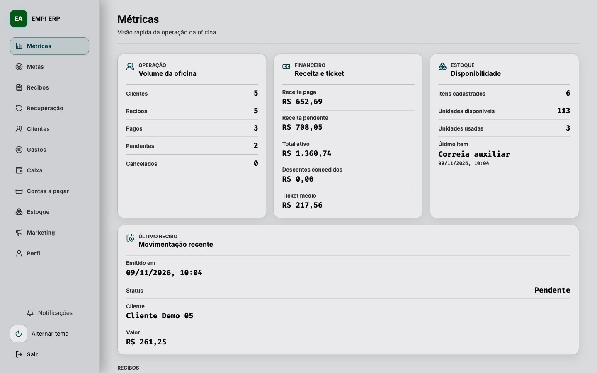
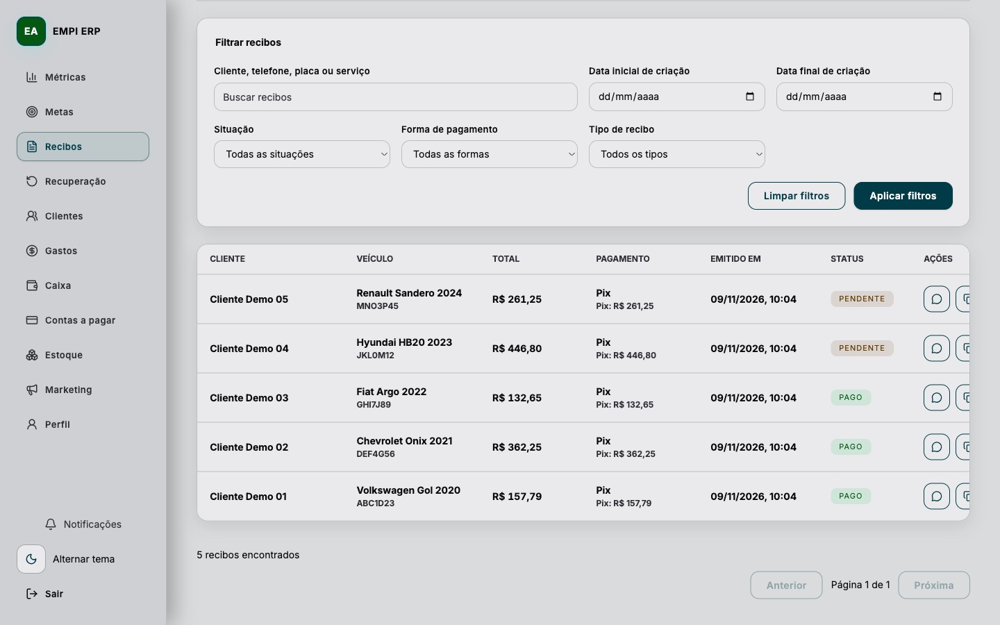
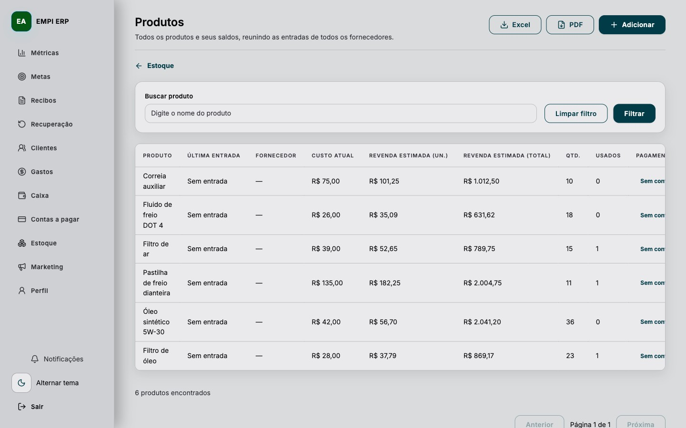

# ERP EMPI Autocenter

Gestão da operação de uma oficina: clientes, recibos, estoque e rotinas financeiras em uma aplicação com **Go, Nuxt 4 e PostgreSQL**.

O projeto conecta o atendimento ao controle dos produtos utilizados e ao acompanhamento dos pagamentos. A implementação reúne API, frontend, testes e documentação no mesmo repositório.

[Telas](#telas-do-sistema) · [Funcionalidades](#funcionalidades) · [Arquitetura](#arquitetura) · [Execução local](#execução-local) · [Testes](#testes) · [Nota técnica](#nota-técnica)

## Telas do sistema

Capturas da interface real, executada em ambiente local isolado com **dados fictícios de demonstração**. Os nomes, veículos e valores exibidos não representam a operação da oficina. As capturas usam os serviços Go do projeto e SQLite em memória; o banco configurado para a aplicação é PostgreSQL.

Interface registrada a partir da revisão [`69fde53`](https://github.com/PedroHRFerreira/erp-empi/tree/69fde53), com o mesmo fluxo visual da aplicação.

### Visão geral

Métricas para acompanhar recibos, recebimentos e o resumo financeiro.



<details>
<summary><strong>Ver recibos e estoque</strong></summary>

### Recibos

Consulta dos atendimentos, produtos utilizados, valores e situação dos pagamentos.



### Estoque

Acompanhamento dos produtos, quantidades disponíveis, custos e preços de revenda.



</details>

## Funcionalidades

| Área | O que o projeto implementa |
| --- | --- |
| Clientes | Cadastro associado ao recibo, listagem e histórico de atendimento. |
| Recibos | Criação completa ou rápida, serviços, produtos, pagamento, cancelamento e reabertura conforme o estado do recibo. |
| Estoque | Cadastro e manutenção de produtos, quantidades, custo, margem, exportação CSV e impressão/PDF. |
| Compras e contas a pagar | Entrada de produtos, fornecedores, parcelas, vencimentos e registro de pagamento. |
| Caixa e gastos | Abertura e fechamento do caixa, movimentações, ajustes e registro de gastos. |
| Acompanhamento | Métricas, resumo financeiro e metas mensais. |
| Documentos | Impressão de recibos e ações para compartilhar pelo WhatsApp ou copiar texto para Instagram. |

### Do recibo ao estoque

1. O atendimento registra cliente, veículo, serviços e produtos utilizados.
2. A confirmação de pagamento verifica o estado persistido do recibo dentro de uma transação.
3. Os produtos são descontados do estoque e o recibo passa para o estado pago.
4. Repetir a confirmação do mesmo recibo pago retorna sem aplicar novamente a baixa.

Esse comportamento está em [`ReceiptService.MarkPaid`](internal/domain/receipts/services/receipt_service.go) e é exercitado pelo teste `TestMarkPaidDecreasesStockOnce`.

## Arquitetura

O repositório reúne um backend Go organizado por domínio e um frontend Nuxt com componentes, stores e contratos tipados.

| Camada | Tecnologias e responsabilidade |
| --- | --- |
| Interface | Nuxt 4, Vue 3, TypeScript, Pinia e SCSS. |
| BFF | Rotas explícitas do Nitro em `frontend/server/api`, que encaminham as chamadas para a API Go. |
| API | Go, Echo e GORM, com handlers HTTP, serviços e repositórios. |
| Persistência | PostgreSQL; valores monetários armazenados em centavos. |
| Execução local | Docker Compose para frontend, API e banco. |

Na execução com servidor Nuxt: **navegador → BFF Nitro → API Go → PostgreSQL**. A configuração de publicação estática pode direcionar o frontend à API; consulte [deploy](docs/deploy.md) e [`render.yaml`](render.yaml).

```text
cmd/api/                 Entrada e inicialização da API
cmd/migrate/             Comando de migração
internal/api/http/       Rotas, handlers e middleware
internal/domain/         Entidades, serviços e repositórios
internal/infra/          Banco e infraestrutura
frontend/app/            Páginas, componentes, stores e utilitários
frontend/server/api/     BFF Nitro
frontend/e2e/            Jornadas de teste com Playwright
docs/                    Arquitetura, segurança e operação
```

## Execução local

### Com Docker Compose

1. Prepare o arquivo de ambiente com `make setup`.
2. Ajuste `.env` com as configurações locais do banco, os valores `ADMIN_*` e `JWT_ACCESS_SECRET`. O administrador inicial é criado a partir dessas variáveis.
3. Suba os serviços:

```sh
docker compose up --build
```

| Serviço | Endereço local |
| --- | --- |
| Frontend | `http://localhost:3000` |
| Saúde da API | `http://localhost:8080/health` |
| PostgreSQL | `localhost:5432` |

### Sem Docker

Use Go compatível com o `go.mod`, Node.js compatível com Nuxt 4 e pnpm na versão indicada em `frontend/package.json`. Configure um PostgreSQL local e ajuste `DB_WRITE_DSN` em `.env` para esse banco.

Na raiz do repositório, prepare o banco e inicie a API:

```sh
go run ./cmd/migrate
go run ./cmd/api
```

Em outro terminal, inicie o frontend com a API local:

```sh
pnpm --dir frontend install --frozen-lockfile
NUXT_API_BASE=http://localhost:8080 pnpm --dir frontend dev
```

O comando de migração é explícito. Para manutenção de uma base existente, consulte [migrações](migrations/README.md).

## Testes

Os comandos abaixo existem nos scripts do projeto:

```sh
# Testes Go e testes unitários do frontend
make test

# Apenas backend
go test ./...

# Tipos e testes unitários do frontend
pnpm --dir frontend lint
pnpm --dir frontend test

# Jornadas E2E, com frontend e API em execução
pnpm --dir frontend test:e2e
```

Os testes E2E usam Playwright e possuem projetos desktop, tablet e mobile. Se o Chromium ainda não estiver instalado, execute `pnpm --dir frontend exec playwright install chromium`. As credenciais podem ser fornecidas com `E2E_ADMIN_CPF` e `E2E_ADMIN_PASSWORD`; use uma base de teste, pois há jornadas que criam e alteram registros.

Para executar apenas o caso de baixa única do estoque:

```sh
go test ./internal/domain/receipts/services -run '^TestMarkPaidDecreasesStockOnce$' -count=1 -v
```

Esse teste usa SQLite em memória e confirma duas chamadas sequenciais para o mesmo recibo. Seu resultado não comprova concorrência entre conexões no PostgreSQL.

## Nota técnica

[**Como evitar baixa duplicada no estoque ao pagar um recibo**](https://gist.github.com/PedroHRFerreira/daebd82e1e1eaa891e4c9540a81b3691)

Explicação do fluxo transacional, código original, teste existente e limites da validação, com referências fixadas na revisão analisada.

## Documentação

- [Arquitetura](docs/architecture.md)
- [Segurança](docs/security.md)
- [Deploy](docs/deploy.md)
- [Migrações](migrations/README.md)
- [Frontend](frontend/README.md)
- [BFF Nitro](frontend/server/README.md)
